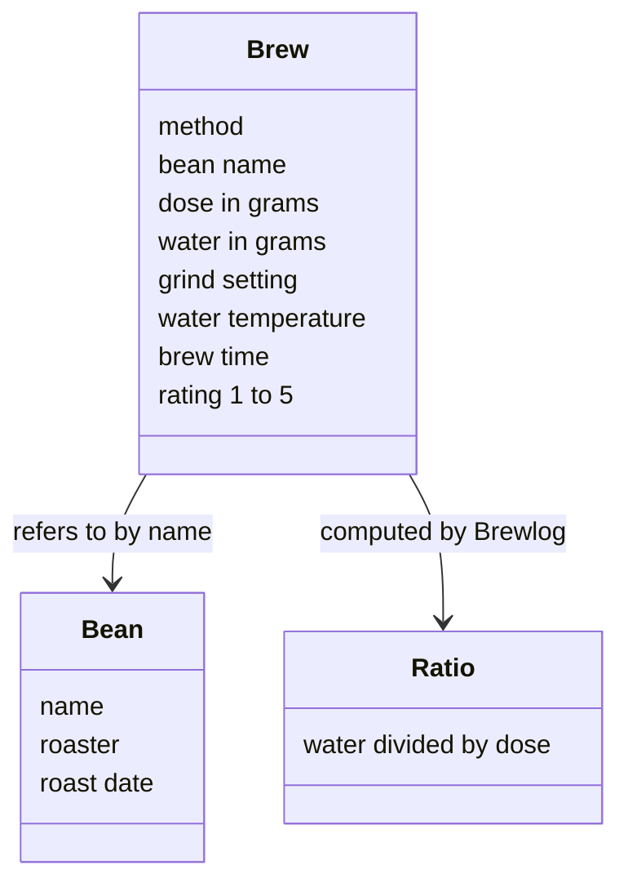
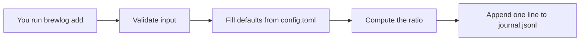
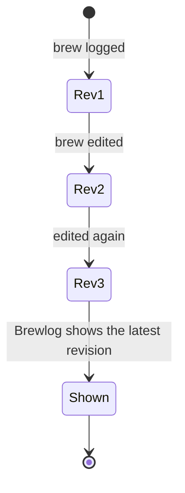

# Chapter 1: Getting Started with Brewlog

> **Prerequisites:** None.

## What You'll Learn

- Explain the problem Brewlog solves for home brewers who change one variable at a time
- Install Brewlog with `pip` and confirm the install with `brewlog --version`
- Find the journal folder at `~/.brewlog/` and say what `journal.jsonl` and `config.toml` each hold
- Define the four core ideas: brew, bean, method, and ratio
- Calculate a brew ratio yourself so you can read the ratio Brewlog shows you
- Describe how a brew is recorded and why edits never rewrite an existing line

## Why Brewlog Exists

Good coffee at home is mostly a matter of patient experiments. You brew a cup, taste it, and decide it was a little sour. Tomorrow you grind finer. The day after, you try a slightly hotter kettle. The approach is sound: change one variable at a time (grind size, dose, water temperature, or brew time) so you know which change made the difference.

The weak link is memory. By the end of the week you have tasted seven cups and changed four things, and you can no longer say whether Tuesday's sweet cup came from the finer grind or the fresher bag. Brewlog fixes that. It is a small command-line tool that keeps a plain-text journal of every brew, so you can look back, compare results, and find the recipes that work.

> **Note:** Brewlog is a fictional tool, invented for the AI Book Forge example book. The ideas in this chapter are a fair model of how a brewing journal works, but you won't find Brewlog in a real package index.

Two design choices shape everything else in this book:

1. **It is a command-line tool.** You log a brew by typing one command, which keeps the habit quick enough to do every morning.
2. **The journal is plain text.** Your data lives in ordinary files in a folder you can see, back up, and read with any text editor.

## Installing Brewlog

Brewlog ships as a single Python package and needs Python 3.10 or later. If you already use Python, installing it is one command, and checking the install is a second:

```bash
pip install brewlog
brewlog --version
```

`pip` downloads the package and puts the `brewlog` command on your path. Running `brewlog --version` proves the command is installed and reachable from your shell. It is the only Brewlog command you run in this chapter; Chapter 2 covers the full command set.

> **Tip:** If your system has more than one Python installed, check which one `pip` belongs to before you install. Brewlog needs 3.10 or later, so an older interpreter will not do.

## The Journal Folder

The first run of Brewlog creates a journal folder at `~/.brewlog/`. Everything Brewlog knows about your coffee lives in two files inside it:

| File | What it holds |
|---|---|
| `journal.jsonl` | One JSON object per brew, one per line |
| `config.toml` | Your settings |


The `.jsonl` extension means "JSON Lines": each line of the file is a complete JSON object on its own. That format suits a journal well. Adding a brew means adding a line at the end, and a program can read the file one line at a time without loading a single giant document. The note in the picture, "appended, never rewritten," is the journal's most important rule; "How a Brew Is Recorded" later in this chapter explains it.

`config.toml` is where your personal defaults go, such as the method you use most. You don't need to touch it yet. Chapter 3 explains every setting it accepts and how settings interact.

> **Note:** The source material doesn't say what fields a line in `journal.jsonl` contains or what they are named, so this book doesn't show a sample line. Treat the file as Brewlog's to write; you read your brews back through Brewlog's own commands in Chapter 2.

## Core Ideas: Brew, Bean, Method, and Ratio

Brewlog's vocabulary is small. Four words cover almost everything you will log.

### Brew

A **brew** is one cup or pot. Brewlog describes it with these pieces of information:

| Part of a brew | What it means |
|---|---|
| Method | How you brewed it (see below) |
| Bean | Which coffee you used, by name |
| Dose | Coffee, in grams |
| Water weight | Water, in grams |
| Grind setting | Where your grinder was set |
| Water temperature | How hot the water was |
| Brew time | How long the brew took |
| Rating | Your verdict, from 1 to 5 |

Most of these are the variables you change in an experiment. The rating is the result. Logging both, every time, is what lets you connect a change to its effect.

### Bean

A **bean** is a named coffee you buy, with a roaster and a roast date. You give each bean a name, and brews refer to the bean by that name. Separating beans from brews means you record the roaster and roast date once, then reuse the name for every cup you make from that bag.

### Method

A **method** is how you brew. Brewlog knows five:

| Method | Brewing style |
|---|---|
| `v60` | Pour-over cone |
| `aeropress` | AeroPress |
| `french-press` | French press |
| `espresso` | Espresso |
| `moka` | Moka pot |

Write methods as shown, in lowercase with the hyphen in `french-press`. The companion project in this book uses `v60` throughout.

> **Note:** The source material lists the five method names but doesn't say how Brewlog handles other spellings, such as `V60` or `frenchpress`.

### Ratio

The **ratio** is water weight divided by dose. Brewlog computes it for you and shows it in the form `1:16`, which reads as "one part coffee to sixteen parts water."

Ratio is the number brewers use to compare recipes of different sizes. A 15 gram dose with 240 grams of water and a 20 gram dose with 320 grams of water are different amounts of coffee, but both work out to 1:16, so they should taste similar in strength. Because Brewlog does the division, you never enter the ratio yourself; you give the dose and (usually) the water weight. Chapter 2 shows what Brewlog does when you leave the water out.



## How a Brew Is Recorded

When you log a brew with `brewlog add` (the command itself is the subject of Chapter 2), Brewlog does four things in order:

1. **Validates your input**, so a bad value is caught before it reaches the journal.
2. **Fills in defaults** from `config.toml` for anything you left out.
3. **Computes the ratio** from the dose and water weight.
4. **Appends one line** to `journal.jsonl`.



### Append-Only Revisions

The most important rule about the journal is this: **nothing is ever rewritten in place.** When you edit a brew, Brewlog does not change its existing line. It appends a new version of the brew with the same id and a higher `rev` number. When Brewlog shows you the brew, it shows the latest revision.

Suppose you log a brew, then realize an hour later that the cup tasted better as it cooled and want to raise its rating. The journal keeps both versions:



Why work this way? An append-only journal has a few practical advantages:

- **History is never lost.** Every earlier version of a brew stays in the file, so a mistaken edit doesn't destroy the original record.
- **Writing is simple and safe.** Adding a line to the end of a file is a small operation. Brewlog never has to rewrite the whole journal to change one brew.
- **The id stays stable.** A brew keeps the same id across every revision, so you can always refer to "that brew" no matter how many times you correct it.

> **Note:** The source material doesn't say how revision numbers start (for example, whether the first version is `rev` 1 or 0). The diagram above labels them Rev1, Rev2, and Rev3 for illustration only.

## Hands-On: Install Brewlog and Plan Your First Brew

In this exercise you install Brewlog, confirm it works, look at the journal folder, and plan the first brew of the companion project. You log nothing yet; Chapter 2 takes it from here.

**Step 1: Check your Python version.** Brewlog needs Python 3.10 or later. Check with your usual Python command:

```bash
python3 --version
```

Expected result: a version of 3.10 or higher. If it is older, upgrade Python before continuing.

**Step 2: Install Brewlog and confirm the install.**

```bash
pip install brewlog
brewlog --version
```

Expected result: `pip` finishes without errors, and `brewlog --version` prints a version instead of a "command not found" error.

> **Note:** The source material doesn't show the exact text `brewlog --version` prints, so this book doesn't either. Any version string means the install worked.

**Step 3: Look at the journal folder.** List the folder Brewlog uses:

```bash
ls ~/.brewlog/
```

Expected result: once Brewlog has created its journal folder, you see the folder's contents, which include `journal.jsonl` and `config.toml`.

> **Note:** The sources say "the first run" creates `~/.brewlog/` but don't say whether `brewlog --version` counts as that run. If the folder doesn't exist yet, that's fine. It will appear once you start logging in Chapter 2.

**Step 4: Plan your first brew on paper.** Before you log anything, write down a starting recipe for a `v60` brew. Fill in each part of a brew from the table in "Core Ideas": the method, a bean name, a dose, a water weight, a grind setting, a water temperature, and a target brew time. Leave the rating blank; you fill that in after you taste.

**Step 5: Work out the ratio.** Divide your water weight by your dose. For example, 240 grams of water over a 15 gram dose gives 16, written 1:16. Write your ratio next to your recipe. In Chapter 2, when Brewlog computes the ratio for you, compare its answer with yours.

**Step 6: Choose your one variable.** Decide which single variable you will change first: grind, dose, temperature, or brew time. Keep everything else fixed, and change only that one variable from one brew to the next. This is the experiment you will log in Chapter 2, where the sample week starts by changing grind.

## Summary

Brewlog exists because home brewers run careful experiments and then forget what they changed. It is a small command-line tool, installed with `pip` on Python 3.10 or later, that keeps a plain-text journal in `~/.brewlog/`. Inside that folder, `journal.jsonl` holds one JSON object per brew and `config.toml` holds your settings.

Four ideas carry the rest of the book. A brew is one cup or pot with a method, bean, dose, water weight, grind, temperature, time, and rating. A bean is a named coffee with a roaster and roast date. A method is one of `v60`, `aeropress`, `french-press`, `espresso`, or `moka`. The ratio is water divided by dose, computed for you and shown as `1:16`. Every brew goes through validation, defaults, and ratio calculation before it is appended to the journal, and edits append a new revision rather than rewriting old lines.

Key takeaways:

- Change one variable at a time, and log every brew so you can connect changes to results.
- Install with `pip install brewlog` and check with `brewlog --version`.
- `journal.jsonl` is append-only: edits add a new revision with the same id and a higher `rev`, and Brewlog shows the latest.
- You never enter the ratio; Brewlog works it out from the dose and water.
- Commands are covered in Chapter 2, and settings in Chapter 3.

## Exercises

1. Install Brewlog and run `brewlog --version`. Write down the version it reports and the Python version you installed it under.
2. Pick a bean you own. Write down the three things Brewlog records about a bean, and fill them in for your bag.
3. Calculate the ratio for each of these recipes: 18 grams of coffee with 288 grams of water, and 20 grams with 300 grams. Which recipe is stronger?
4. A friend uses a French press and a moka pot. Write the Brewlog method name for each, as Brewlog lists it.
5. You log a brew, then edit its rating twice. Describe what the journal now contains for that brew, and which version Brewlog shows you.
6. Plan a week of seven `v60` brews where only one variable changes. List each day's recipe and mark the variable you are changing.

## Quiz

1. What problem does Brewlog solve for home brewers?
2. Which Python version does Brewlog need at minimum?
3. What does each line of `journal.jsonl` hold?
4. Which of these is *not* one of Brewlog's methods: `v60`, `chemex`, `aeropress`, `moka`?
5. How does Brewlog calculate the ratio, and how does it display it?
6. When you run `brewlog add`, what are the four steps Brewlog performs, in order?
7. True or false: editing a brew changes its existing line in `journal.jsonl`.
8. When a brew has several revisions, which one does Brewlog show you?
