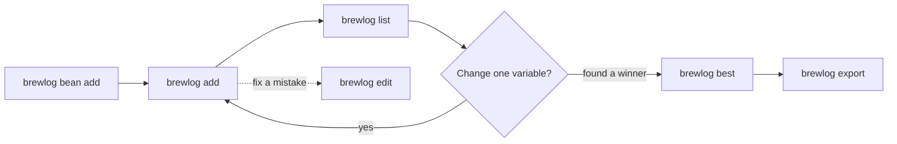
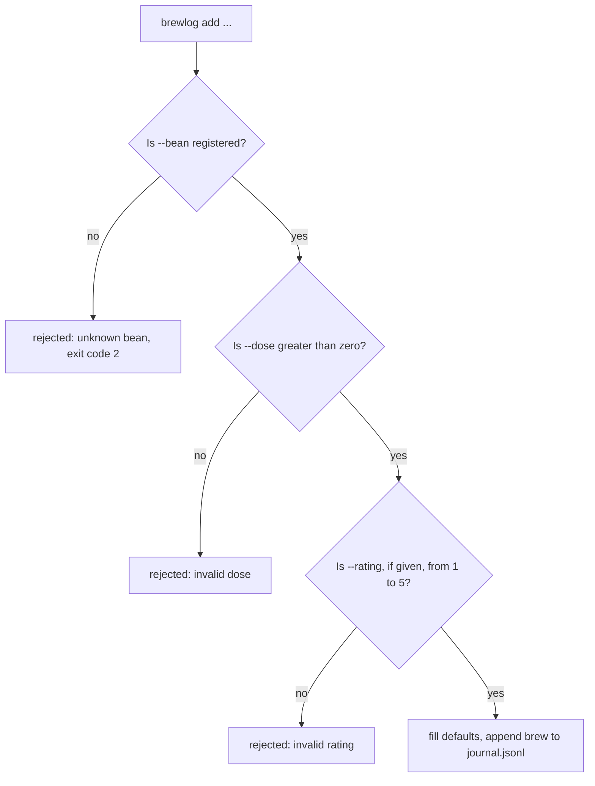
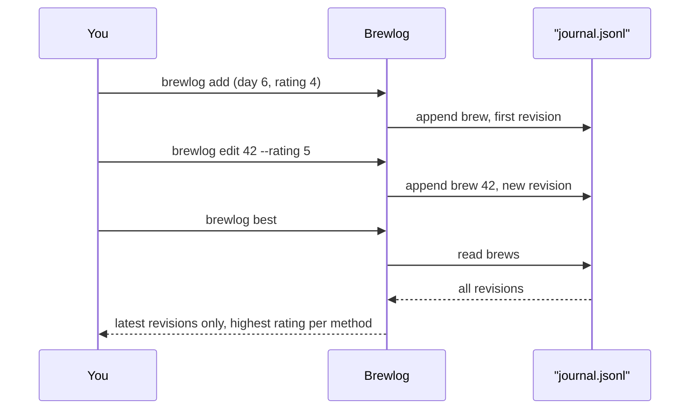

# Chapter 2: Logging and Comparing Brews

> **Prerequisites:** Chapter 1.

Chapter 1 gave you the ideas behind Brewlog: a brew, a bean, a method, and a ratio, all recorded in an append-only journal. This chapter puts those ideas to work. You will use every Brewlog command, learn what each option does and what Brewlog refuses to accept, and build a week of V60 brews that you can compare and export.

## What You'll Learn

- Register a bean with `brewlog bean add` before you brew with it
- Log a brew with `brewlog add`, using every option and knowing which ones are required
- Predict which inputs Brewlog rejects and why
- Filter your history with `brewlog list` and find your best recipe with `brewlog best`
- Correct a past brew with `brewlog edit` without losing the original
- Export your journal to CSV or JSON with `brewlog export`
- Point any command at a different journal folder with `--journal`

## The Shape of a Brewlog Session

Every Brewlog command works against a journal folder. By default that folder is `~/.brewlog/`, and every command accepts `--journal PATH` to use a different one. That single shared option means you can keep a separate journal for testing, for a second household member, or for a coffee you only brew at the office, without changing anything else about how you work.

A typical session follows a simple loop. You register a bean once, then log brews against it, then look back over what you logged to decide what to change next.



The order matters at the start: a brew refers to its bean by name, so the bean has to exist first. After that, `add`, `list`, `edit`, and `best` can happen in any order you like, and `export` is how you take the data somewhere else.

## Registering Beans

A bean is the coffee you bought. You register it once and refer to it by name in every brew:

```bash
brewlog bean add "Ethiopia Guji" --roaster "Northside" --roasted 2026-10-28
```

Two rules apply:

- The name must be unique. You can't register two beans with the same name, so if you buy a second bag of the same coffee from a later roast, give it a distinguishing name.
- `--roasted` is optional. When you use it, give the date in `YYYY-MM-DD` form.

Quote the name whenever it contains a space, as in `"Ethiopia Guji"`. Without quotes your shell would split it into two arguments.

> **Note:** The source material doesn't say whether `--roaster` is required or optional, or what happens if you try to register a duplicate name beyond the fact that names must be unique. Include `--roaster` to be safe.

## Logging a Brew with `brewlog add`

`brewlog add` records one brew. Here is a fully specified example:

```bash
brewlog add --method v60 --bean "Ethiopia Guji" --dose 15 --water 250 --grind 22 --temp 94 --time 3:10 --rating 4
```

Each option maps to one part of the brew. Two are required; the rest either fall back to a configured default or are simply left empty.

| Option | Meaning | Default |
|---|---|---|
| `--method` | Brew method | `default_method` from config |
| `--bean` | A registered bean name | required |
| `--dose` | Coffee in grams | required |
| `--water` | Water in grams | `dose * default_ratio` |
| `--grind` | Grinder setting, any number | none |
| `--temp` | Water temperature in Celsius | `default_temp` from config |
| `--time` | Brew time as `M:SS` | none |
| `--rating` | 1 to 5 | none |
| `--note` | Free text | none |

A few of these deserve a closer look.

**`--water` depends on `--dose`.** If you leave out `--water`, Brewlog multiplies your dose by `default_ratio` to get it. That is why `--dose` is required: without it Brewlog has nothing to compute from. Chapter 3 covers `default_ratio`, `default_method`, and `default_temp`, including their built-in values and how to change them.

**`--grind` is just a number.** Brewlog doesn't know your grinder. It stores whatever number you give it, so use the scale printed on your own grinder and stay consistent.

**`--time` uses `M:SS`.** Three minutes and ten seconds is `3:10`.

**`--rating` and `--note` are where comparisons come from.** You can log a brew without a rating, but `brewlog best` and `--min-rating` both work from ratings, so rate your brews to give them something to compare.

### What Brewlog rejects

Brewlog checks your input before it writes anything. It rejects:

- a rating outside 1 to 5
- a dose of zero or less
- an unknown bean name (exit code 2)



> **Note:** The source material gives exit code 2 for an unknown bean name. It doesn't say which exit code the other rejections use, or the order in which Brewlog runs the checks. The diagram shows one plausible order. It also doesn't say how Brewlog handles a `--time` value that isn't in `M:SS` form.

## Reviewing Your History with `brewlog list`

`brewlog list` prints a table of brews, newest first:

```bash
brewlog list --bean "Ethiopia Guji" --method v60 --last 10
```

| Option | Effect | Default |
|---|---|---|
| `--bean` | Only brews of this bean | all beans |
| `--method` | Only brews with this method | all methods |
| `--last N` | Show at most N brews | 20 |
| `--min-rating N` | Hide brews rated below N | show all |

Because the newest brew comes first, `--last 7` after a week of daily brewing shows you exactly that week. Combine it with `--min-rating 4` when you only want to see the cups worth repeating.

> **Note:** The source material doesn't describe the columns of the `list` table or how unrated brews are treated by `--min-rating`.

## Finding Your Best Recipe with `brewlog best`

```bash
brewlog best --bean "Ethiopia Guji"
```

`brewlog best` shows the highest-rated brew for each method you have used with that bean. If you brewed the bean as a V60 and as an AeroPress, you get one winner for each. When two brews share the top rating, the most recent one wins. That tie-break suits the one-variable-at-a-time approach: if your latest change matched your previous best, the newer recipe is the one shown.

## Correcting a Brew with `brewlog edit`

You will sometimes rate a cup too early or forget a note. `brewlog edit` fixes that:

```bash
brewlog edit 42 --rating 5 --note "sweeter after resting the beans"
```

Here `42` is the brew's id. Brewlog doesn't overwrite brew 42. It appends a new revision of brew 42 containing the fields you changed. Chapter 1 explains the revision model; what matters here is the effect: your history stays intact, and every command shows the latest revision.

> **Note:** The source material doesn't list which options `edit` accepts beyond `--rating` and `--note` in its example, and doesn't say where Brewlog displays a brew's id.

## Exporting with `brewlog export`

```bash
brewlog export --format csv > brews.csv
```

`brewlog export` supports two formats, `csv` and `json`. The example redirects the output into a file with `>`, which is how you capture it. Export always writes the latest revision of each brew, so edits are reflected and older revisions don't appear as duplicates.

Use CSV when you want to open your brews in a spreadsheet and chart grind against rating. Use JSON when another program will read the data.

## Hands-On: A Week of V60 Brews

This picks up the plan you made in Chapter 1's Hands-On. You will register one bean, brew it as a V60 every day for a week, change exactly one variable each day, fix a rating, find the best brew, and export the results. The sample week changes grind first, then temperature, then water; if you chose a different variable in Chapter 1, swap in your own values but keep to one change per brew. Every brew below sets `--water` and `--temp` explicitly, so your results don't depend on the defaults covered in Chapter 3.

**Step 1: Register the bean.**

```bash
brewlog bean add "Ethiopia Guji" --roaster "Northside" --roasted 2026-10-28
```

**Step 2: Log the baseline brew (day 1).** This is the source example, unchanged:

```bash
brewlog add --method v60 --bean "Ethiopia Guji" --dose 15 --water 250 --grind 22 --temp 94 --time 3:10 --rating 4
```

**Step 3: Change grind only (days 2 to 4).** Keep everything else fixed, note the brew time you observe, and rate honestly. These times and ratings are sample values; record your own.

```bash
brewlog add --method v60 --bean "Ethiopia Guji" --dose 15 --water 250 --grind 20 --temp 94 --time 3:30 --rating 4 --note "day 2: finer"
brewlog add --method v60 --bean "Ethiopia Guji" --dose 15 --water 250 --grind 18 --temp 94 --time 3:55 --rating 3 --note "day 3: finer, a bit bitter"
brewlog add --method v60 --bean "Ethiopia Guji" --dose 15 --water 250 --grind 24 --temp 94 --time 2:50 --rating 3 --note "day 4: coarser, thin"
```

**Step 4: Return to the best grind and change temperature only (days 5 and 6).**

```bash
brewlog add --method v60 --bean "Ethiopia Guji" --dose 15 --water 250 --grind 22 --temp 92 --time 3:10 --rating 4 --note "day 5: cooler"
brewlog add --method v60 --bean "Ethiopia Guji" --dose 15 --water 250 --grind 22 --temp 96 --time 3:05 --rating 4 --note "day 6: hotter"
```

**Step 5: Change water only (day 7).**

```bash
brewlog add --method v60 --bean "Ethiopia Guji" --dose 15 --water 240 --grind 22 --temp 94 --time 3:00 --rating 4 --note "day 7: less water"
```

**Step 6: Review the week.**

```bash
brewlog list --bean "Ethiopia Guji" --method v60 --last 7
```

Expected result: seven brews, with day 7 at the top and day 1 at the bottom.

**Step 7: Fix a rating.** Suppose day 6 tasted better after it cooled. Edit it by its id. As the Note in "Correcting a Brew with `brewlog edit`" says, the sources don't say where Brewlog shows a brew's id, so check your `list` output for it. The command below uses `42` as a stand-in for that id:

```bash
brewlog edit 42 --rating 5 --note "sweeter after resting the beans"
```

Run the `list` command from Step 6 again. The day 6 brew now shows rating 5.

**Step 8: Find the winner.**

```bash
brewlog best --bean "Ethiopia Guji"
```

Expected result: one line for `v60`, showing the day 6 brew, since it is now the only brew rated 5.

**Step 9: Export.**

```bash
brewlog export --format csv > brews.csv
```

Expected result: `brews.csv` contains each of your seven brews once, with day 6 at its edited rating.

## Quick Reference

| Command | Purpose | Options |
|---|---|---|
| `brewlog bean add NAME` | Register a bean (unique name) | `--roaster`, `--roasted YYYY-MM-DD` (optional) |
| `brewlog add` | Log a brew | `--method`, `--bean`, `--dose`, `--water`, `--grind`, `--temp`, `--time`, `--rating`, `--note` |
| `brewlog list` | Table of brews, newest first | `--bean`, `--method`, `--last N` (default 20), `--min-rating N` |
| `brewlog edit ID` | Append a revision with changed fields | changed fields, such as `--rating`, `--note` |
| `brewlog best` | Highest-rated brew per method for a bean | `--bean` |
| `brewlog export` | Write latest revision of each brew | `--format csv` or `--format json` |
| any command | Use another journal folder | `--journal PATH` (default `~/.brewlog/`) |

| `add` rule | Result |
|---|---|
| `--bean` and `--dose` missing | Both are required |
| Rating outside 1 to 5 | Rejected |
| Dose of zero or less | Rejected |
| Unknown bean name | Rejected, exit code 2 |
| `--water` omitted | `dose * default_ratio` |
| `--method` or `--temp` omitted | `default_method` or `default_temp` from config |

## Under the Hood

Each brew command touches the journal in one of two ways: it appends, or it reads.

`add` and `edit` append. `add` validates your input, fills in defaults, and appends one brew. `edit` appends a new revision of an existing brew with the fields you changed, rather than rewriting the old line. As Chapter 1 describes, the journal is append-only, and Brewlog shows the latest revision of each brew.

`list`, `best`, and `export` read. They all see the latest revision of each brew, which is why an edited rating changes what `best` picks and what `export` writes.

> **Note:** The source material doesn't say where Brewlog stores beans, so this book doesn't say whether `bean add` writes to `journal.jsonl`.



> **Note:** `best` breaks ties in favor of the most recent brew. The source material doesn't say whether editing an older brew makes it count as more recent for that tie-break.

## Pitfalls and Troubleshooting

| Symptom | Likely cause | Fix |
|---|---|---|
| `add` fails with exit code 2 | The bean name isn't registered | Run `brewlog bean add` first, and match the name exactly. Chapter 3 covers this error and bean name case sensitivity. |
| `add` rejects your brew | Rating outside 1 to 5, or dose of zero or less | Correct the value and run the command again |
| A bean name gets split | Missing quotes around a name with spaces | Quote it: `--bean "Ethiopia Guji"` |
| `list` doesn't show older brews | `--last` defaults to 20 | Pass a larger `--last N` |
| A brew you expected is missing from `list` | `--min-rating` hides lower-rated brews | Lower or drop `--min-rating` |
| Your brews seem to have vanished | You used `--journal` with a different folder, or forgot it | Run the command with the same `--journal PATH` you logged with |
| You changed two variables and can't tell which helped | Too many changes in one brew | Change one variable per brew, as in the Hands-On |
| `--water` isn't what you expected | You omitted it, so Brewlog used `dose * default_ratio` | Pass `--water` explicitly, or see Chapter 3 to set `default_ratio` |

## Summary

Brewlog's command set is small and each command has one job. `brewlog bean add` registers a coffee once, `brewlog add` records a brew with two required options and sensible fallbacks for the rest, `list` and `best` let you look back, `edit` corrects history by appending, and `export` takes your latest data out in CSV or JSON. The shared `--journal` option lets every command work against any journal folder.

The Hands-On showed the habit Brewlog is built for: change one variable per brew, rate each cup, and let `best` tell you which recipe won.

Key takeaways:

- Register a bean before you brew with it; names must be unique.
- `--bean` and `--dose` are required; `--water`, `--method`, and `--temp` fall back to defaults covered in Chapter 3.
- Brewlog rejects ratings outside 1 to 5, doses of zero or less, and unknown beans (exit code 2).
- `list` is newest first and shows 20 brews unless you pass `--last`.
- `best` picks the top rating per method, and ties go to the most recent brew.
- `edit` appends a revision; `export` writes only the latest revision of each brew.

## Exercises

1. Register a second bean of your choice, without `--roasted`. Then log one V60 brew of it and confirm that `brewlog list --bean` with that name shows only that brew.
2. Try to log a brew with `--rating 6`, then with `--dose 0`, then with a bean you never registered. Note which ones report exit code 2. (In bash, `echo $?` right after a command prints its exit code.)
3. Brew your second bean with a method other than `v60`, rate it, and run `brewlog best` for that bean. Explain why you see more than one line if you have used two methods.
4. Create a scratch journal with `--journal` in a temporary folder, register a bean and log one brew there, and confirm that your main journal's `list` doesn't include it.
5. Export your main journal in both `csv` and `json` formats. Check that the brew you edited in the Hands-On appears once, with its edited rating, in each file.

## Quiz

1. Which two `brewlog add` options are required?
2. You run `brewlog add` without `--water`. How does Brewlog decide the water weight?
3. Which of these does Brewlog reject? (a) `--rating 5` (b) `--dose 0` (c) `--grind 40` (d) `--temp 96`
4. What exit code does Brewlog return for an unknown bean name?
5. How many brews does `brewlog list` show if you don't pass `--last`, and in what order?
6. Two V60 brews of the same bean are both rated 5. Which one does `brewlog best` show?
7. What does `brewlog edit` do to the original line for a brew?
8. Name the two formats `brewlog export` supports, and say which revision of each brew it writes.
