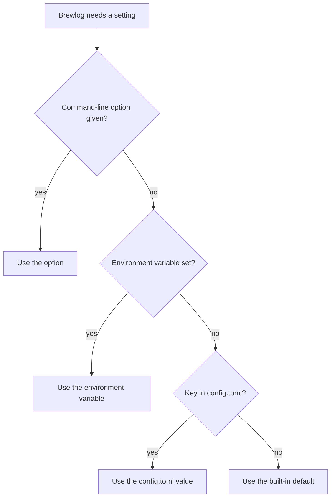
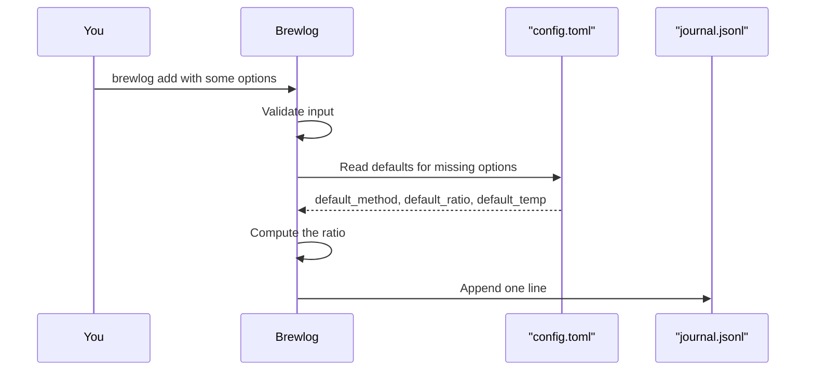
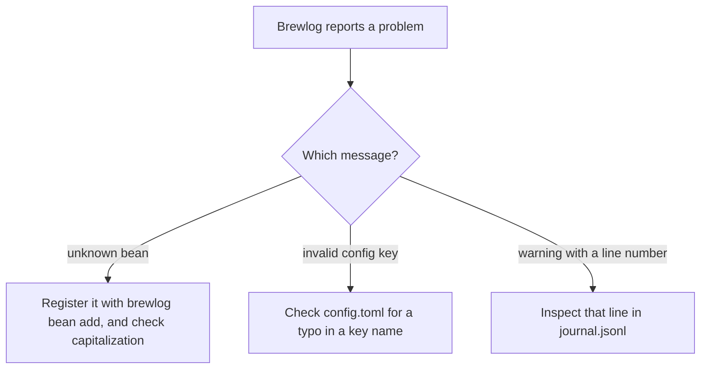

# Chapter 3: Configuring and Troubleshooting Brewlog

> **Prerequisites:** Chapters 1 and 2.

By now your journal holds a week of V60 brews, and you have probably noticed that you type the same values over and over. If nearly every brew you make is a V60 at the same temperature, those numbers belong in a settings file, not on your command line. This chapter shows you how Brewlog decides which value to use for each setting, how to set your own defaults in `config.toml`, and how to fix the handful of errors you are most likely to run into.

## What You'll Learn

- Where Brewlog looks for `config.toml` and what each of its five keys does
- The built-in default for every key, and which `brewlog add` option each one stands in for
- How the `BREWLOG_JOURNAL` and `NO_COLOR` environment variables change Brewlog's behavior
- The precedence order Brewlog follows when the same setting comes from more than one place
- How to tune your own defaults and confirm their effect on `brewlog add`
- How to diagnose and fix "unknown bean", "invalid config key", and corrupt journal lines

## Where Settings Come From

Brewlog reads `config.toml` from the journal folder. In Chapter 1 you saw that the first run creates that folder at `~/.brewlog/`, next to `journal.jsonl`. If you point Brewlog at a different journal folder with `--journal PATH`, it reads the `config.toml` in that folder instead. Each journal carries its own settings, which is handy if you keep, say, a separate journal for espresso experiments.

Every key in the file is optional. A missing key simply falls back to its built-in default, so an empty file (or no file at all) behaves exactly like a file that lists every default. Here is the complete file with every key set to its default value:

```toml
default_method = "v60"
default_ratio = 16
default_temp = 93
units = "metric"
rating_scale = 5
```

TOML is a simple `key = value` format. Strings go in double quotes; numbers do not.

## The Five Configuration Keys

Each key has a narrow job. Three of them supply defaults for `brewlog add`, one controls display, and one is fixed in the current version.

| Key | What it controls | Default | Stands in for |
|---|---|---|---|
| `default_method` | Method used when `--method` is omitted | `"v60"` | `--method` |
| `default_ratio` | Water-to-coffee ratio used when `--water` is omitted | `16` | `--water` |
| `default_temp` | Water temperature in Celsius when `--temp` is omitted | `93` | `--temp` |
| `units` | `metric` or `imperial` display | `"metric"` | none |
| `rating_scale` | The rating scale; fixed at 5 in this version | `5` | none |

### default_method

When you leave out `--method`, Brewlog uses this value. The default, `"v60"`, matches the companion project, so if V60 is your daily brewer you may never need to type `--method` at all. The value should be one of the methods from Chapter 1: `v60`, `aeropress`, `french-press`, `espresso`, or `moka`.

> **Note:** The source material doesn't say what happens if `default_method` names a method outside that list. Stick to the five listed methods.

### default_ratio

This one works a little differently from the others. There is no `--ratio` option on `brewlog add`. Instead, when you leave out `--water`, Brewlog computes the water weight as `dose * default_ratio`. With the default of `16`, a 15 gram dose becomes 240 grams of water. Remember that the ratio Brewlog displays (such as `1:16`) is always computed from the water and dose actually recorded, so if you pass `--water` explicitly, that wins and the ratio follows from it.

### default_temp

The water temperature in Celsius used when you omit `--temp`. The default is `93`. If your kettle is set to a different temperature most mornings, put that number here.

### units

Set `units` to `metric` or `imperial`. Imperial shows ounces and Fahrenheit, but Brewlog still stores grams and Celsius in `journal.jsonl`. That design keeps the journal consistent: switching units changes how brews are displayed, never what is saved, so you can flip back and forth without converting anything.

> **Note:** The source material doesn't say whether `--dose`, `--water`, and `--temp` accept imperial values when `units = "imperial"`, or whether `default_temp` is read as Fahrenheit in that mode. The sources describe all three in grams and Celsius, so keep entering grams and Celsius.

### rating_scale

Ratings run from 1 to 5. The `rating_scale` key exists, but it is fixed at `5` in this version and Brewlog rejects any other value. You can leave it out entirely.

## Environment Variables

Brewlog recognizes two environment variables.

| Variable | Effect |
|---|---|
| `BREWLOG_JOURNAL` | Overrides the journal folder, the same as `--journal`. The command-line option wins if both are set. |
| `NO_COLOR` | Turns off colored output. |

`BREWLOG_JOURNAL` is useful when you want a different journal for a whole terminal session without adding `--journal` to every command. Because `config.toml` lives inside the journal folder, changing the journal folder also changes which `config.toml` is read. There is no config key for the journal location; you choose it only with `--journal` or `BREWLOG_JOURNAL`.

`NO_COLOR` is handy when you pipe output into another program or a log file, where color codes only add noise.

> **Note:** The source material doesn't say what value `NO_COLOR` needs. The examples in this chapter set it to `1`.

## Precedence: Who Wins

The same setting can come from several places. For every setting, Brewlog uses the first value it finds in this order:

1. The command-line option
2. The environment variable, where one exists
3. `config.toml`
4. The built-in default



Only the journal folder has an environment variable, so for most settings the chain is shorter. Here is how it plays out for each one:

| Setting | 1. Option | 2. Environment | 3. config.toml | 4. Built-in |
|---|---|---|---|---|
| Journal folder | `--journal` | `BREWLOG_JOURNAL` | none | `~/.brewlog/` |
| Method | `--method` | none | `default_method` | `"v60"` |
| Water | `--water` | none | `default_ratio` (times dose) | `16` (times dose) |
| Temperature | `--temp` | none | `default_temp` | `93` |

The practical rule: put your everyday values in `config.toml`, and override them on the command line for the one-off brew. You never need to edit the file just to try something different once.

## Hands-On: Tune Your Morning Defaults

In this exercise you write a `config.toml` that matches how you actually brew, then confirm that `brewlog add` picks up the new defaults. You will use the "Ethiopia Guji" bean you registered in Chapter 2.

Suppose your week of experiments showed that 94 degrees and a slightly stronger 1:15 ratio work best for you. Set those as your defaults.

**Step 1: Write the config file.** Open `~/.brewlog/config.toml` in your editor (create it if it doesn't exist) and give it this content:

```toml
default_method = "v60"
default_ratio = 15
default_temp = 94
```

You don't need the other two keys; they fall back to their defaults.

**Step 2: Log a brew using only the defaults.** Leave out `--method`, `--water`, and `--temp`:

```bash
brewlog add --bean "Ethiopia Guji" --dose 15 --grind 22 --time 3:10 --rating 4
```

Expected result: Brewlog records a V60 brew with 225 grams of water (15 times 15) at 94 degrees Celsius. Before this change, the same command would have recorded 240 grams of water at 93 degrees.

**Step 3: Check the result.**

```bash
brewlog list --bean "Ethiopia Guji" --last 1
```

Expected result: the newest brew shows the V60 method, 225 grams of water, a ratio of `1:15`, and a temperature of 94.

**Step 4: Override a default for one brew.** Try a cooler brew without touching the file:

```bash
brewlog add --bean "Ethiopia Guji" --dose 15 --temp 91 --grind 22 --time 3:10 --rating 3
```

Expected result: this brew records 91 degrees, because the command-line option beats `config.toml`. The water is still 225 grams, since you didn't pass `--water`.

**Step 5: Try the environment variables.** Run a listing without color, then point a single session at a scratch journal:

```bash
NO_COLOR=1 brewlog list --last 5
export BREWLOG_JOURNAL=~/brewlog-scratch
brewlog list --journal ~/.brewlog/ --last 5
```

Expected result: the first command prints your recent brews without color. The last command still lists your real journal, because `--journal` wins over `BREWLOG_JOURNAL`. Run `unset BREWLOG_JOURNAL` when you are done so later commands go back to `~/.brewlog/`.

> **Note:** The source material doesn't describe the exact layout of `brewlog list` output, so the expected results above describe values rather than exact screen text.

## Quick Reference

**config.toml keys** (all optional, read from the journal folder):

| Key | Values | Default |
|---|---|---|
| `default_method` | Method used when `--method` is omitted | `"v60"` |
| `default_ratio` | Water-to-coffee ratio used when `--water` is omitted | `16` |
| `default_temp` | Celsius, used when `--temp` is omitted | `93` |
| `units` | `metric` or `imperial` | `"metric"` |
| `rating_scale` | Fixed at 5; other values are rejected | `5` |

**Environment variables:**

| Variable | Effect |
|---|---|
| `BREWLOG_JOURNAL` | Sets the journal folder; `--journal` wins if both are set |
| `NO_COLOR` | Turns off colored output |

**Precedence** (first value found wins): command-line option, environment variable (where one exists), `config.toml`, built-in default.

**Error messages:**

| Message | Fix |
|---|---|
| "unknown bean" | Register the bean with `brewlog bean add`; check capitalization |
| "invalid config key" | Fix the misspelled or unsupported key in `config.toml` |
| Warning naming a line number | A corrupt line in `journal.jsonl` was skipped |

## Under the Hood

Chapter 1 described how a brew is recorded: when you run `brewlog add`, Brewlog validates your input, fills in defaults from `config.toml`, computes the ratio, and appends one line to `journal.jsonl`. Configuration plugs into the middle of that pipeline.



Two points about the journal matter here.

First, because defaults are filled in before the line is appended, the filled-in values are part of what Brewlog writes for that brew. Changing `config.toml` later shouldn't reach back and alter brews you already logged, so your old 93 degree brews stay 93 degree brews, which is exactly what you want when you compare results across a week of changes.

> **Note:** The source material doesn't state outright that config changes leave past brews alone; this follows from the recording order it describes.

Second, the journal is append-only: edits add a new revision rather than rewriting a line. Separately, Brewlog copes with a damaged line by skipping it, warning you with its line number, and loading the rest.

The `units` setting sits entirely on the display side. The journal always holds grams and Celsius, and imperial mode converts only what you see.

## Pitfalls and Troubleshooting



### "unknown bean"

**Symptom:** `brewlog add` refuses a brew and reports "unknown bean". As Chapter 2 covered, Brewlog rejects an unknown bean name with exit code 2.

**Cause:** Either the bean was never registered, or the name you typed doesn't match exactly. Bean names are case-sensitive, so `"ethiopia guji"` is not the same bean as `"Ethiopia Guji"`.

**Fix:** Register it first with `brewlog bean add`, or correct the capitalization to match the registered name.

### "invalid config key"

**Symptom:** Brewlog stops with "invalid config key".

**Cause:** Brewlog stops on any key it doesn't recognize. The usual culprit is a typo, such as `default_temperature` instead of `default_temp`, or `default_ratios` instead of `default_ratio`.

**Fix:** Compare each key in `config.toml` against the five valid keys in the Quick Reference. Strict checking is a feature here: a silently ignored typo would leave you wondering why your new default never took effect.

### A rejected rating_scale

**Symptom:** Brewlog rejects your config after you set `rating_scale = 10`.

**Fix:** `rating_scale` is fixed at 5 in this version and other values are rejected. Remove the line or set it to `5`.

### A corrupt journal line

**Symptom:** Brewlog prints a warning that names a line number in `journal.jsonl`, but otherwise works.

**Cause:** One line of the journal is damaged. The source material doesn't say what typically causes this.

**Fix:** Brewlog skips the corrupt line and loads the rest of the journal, so your other brews are safe. Open the file, look at the named line, and repair or remove it.

> **Warning:** Make a copy of `journal.jsonl` before editing it by hand. The file is meant to be append-only, and a careless edit can damage more lines.

### A default that doesn't seem to apply

**Symptom:** You changed `default_temp`, but a brew still records the old temperature.

**Cause:** Something earlier in the precedence order won. Check whether you passed `--temp`, whether a shell alias or script adds it, and whether Brewlog is reading the `config.toml` you edited. If `BREWLOG_JOURNAL` or `--journal` points at another folder, Brewlog reads that folder's `config.toml`.

## Summary

`config.toml` turns your everyday brewing habits into defaults. It lives in the journal folder, every key is optional, and three of its five keys (`default_method`, `default_ratio`, and `default_temp`) fill in for options you leave off `brewlog add`. The `units` key changes only what you see, and `rating_scale` is fixed at 5. Two environment variables round things out: `BREWLOG_JOURNAL` chooses the journal folder and `NO_COLOR` turns off color. When values conflict, the command-line option wins, then the environment variable, then `config.toml`, then the built-in default.

Most problems trace back to a few causes: an unregistered or miscapitalized bean, a misspelled config key, or a damaged journal line that Brewlog skips with a warning.

Key takeaways:

- Brewlog reads `config.toml` from the journal folder; every key is optional.
- Built-in defaults: `default_method = "v60"`, `default_ratio = 16`, `default_temp = 93`, `units = "metric"`, `rating_scale = 5`.
- Without `--water`, water is `dose * default_ratio`.
- Imperial units change the display only; the journal always stores grams and Celsius.
- Precedence: command-line option, environment variable, `config.toml`, built-in default.
- Defaults are filled in before a brew is appended, so changing them later shouldn't alter past brews.

## Exercises

1. Write a `config.toml` for a brewer who makes AeroPress coffee at 85 degrees with a 1:14 ratio. Then write the shortest `brewlog add` command that logs a 17 gram brew of "Ethiopia Guji" using those defaults, and state how much water it records.
2. With no `config.toml` at all, what method, water weight, and temperature does `brewlog add --bean "Ethiopia Guji" --dose 18` record?
3. Your `config.toml` sets `default_temp = 94`. You run `brewlog add --bean "Ethiopia Guji" --dose 15 --temp 96`. Which temperature is recorded, and why?
4. You set `BREWLOG_JOURNAL=~/espresso-journal` and run `brewlog list --journal ~/.brewlog/`. Which journal is listed, and which `config.toml` applies?
5. A friend's config contains `default_tmp = 92` and Brewlog stops on startup. Diagnose the problem and give the fix.
6. Explain why switching `units` from `metric` to `imperial` and back never changes your journal data.

## Quiz

1. Where does Brewlog look for `config.toml`?
2. What is the built-in default for `default_ratio`, and which `brewlog add` option does it stand in for?
3. Which of these is the correct precedence order, from first to last?
   a. `config.toml`, environment variable, command-line option, built-in default
   b. Command-line option, environment variable, `config.toml`, built-in default
   c. Environment variable, command-line option, built-in default, `config.toml`
4. What happens if you set `rating_scale = 10`?
5. True or false: with `units = "imperial"`, Brewlog stores ounces and Fahrenheit in `journal.jsonl`.
6. Which environment variable turns off colored output?
7. What does Brewlog do when it finds a corrupt line in `journal.jsonl`?
8. You get "unknown bean" for a bean you are sure you registered. What should you check first?
