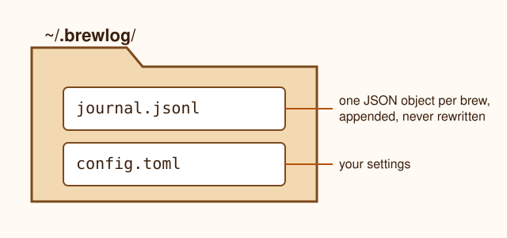

# Brewlog Overview

Brewlog is a small command-line tool for logging coffee brews and finding the recipes that work. It is a fictional tool made up for the AI Book Forge example book.

## Why it exists

Home brewers change one variable at a time (grind size, dose, water temperature, brew time) and then forget what they changed. Brewlog keeps a plain-text journal of every brew so you can compare results later.

## Installing

Brewlog ships as a single Python package and needs Python 3.10 or later.

```bash
pip install brewlog
brewlog --version
```

The first run creates a journal folder at `~/.brewlog/`. Inside it, `journal.jsonl` holds one JSON object per brew, and `config.toml` holds your settings.



## Core ideas

- A **brew** is one cup or pot: a method, a bean, a dose in grams, a water weight in grams, a grind setting, a water temperature, a brew time, and a rating from 1 to 5.
- A **bean** is a named coffee you buy, with a roaster and a roast date. Brews refer to beans by name.
- A **method** is how you brew: `v60`, `aeropress`, `french-press`, `espresso`, or `moka`.
- The **ratio** is water weight divided by dose. Brewlog computes it for you and shows it as `1:16`, for example.

## How a brew is recorded

When you run `brewlog add`, Brewlog validates your input, fills in defaults from `config.toml`, computes the ratio, and appends one line to `journal.jsonl`. Nothing is ever rewritten in place: edits append a new version of the brew with the same id and a higher `rev` number, and Brewlog shows the latest revision.
